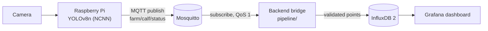

# Calf Monitoring: Edge-to-Dashboard IoT Pipeline

An edge-AI monitoring pipeline: a YOLOv8n detector exported to NCNN for a Raspberry Pi, a lightweight MQTT status stream, and a Mosquitto → InfluxDB → Grafana stack deployed with Docker Compose.

**Background.** This repository is a 2026 rebuild of the data pipeline from my undergraduate research project, *Calves Head Recognition for Dietary Monitoring* (Biophotonics and Bioimaging Lab, National Taiwan University, 2023; oral presentation at the 2023 BIOME Conference). The original 2023 code ran on the lab's Raspberry Pi and is not included, and the lab's image data is not published here.

## Architecture



Why it is built this way:

- **Only a status string leaves the device.** The farm network is unreliable, so the Pi runs the detector locally and publishes a few bytes (`awake` / `asleep`) instead of streaming video.
- **MQTT decouples the device from the database.** Messages use QoS 1 (at-least-once delivery), and the backend reconnects automatically after network drops, so either side can restart independently.
- **One `docker compose up` for the infrastructure.** InfluxDB is initialised with the same token the backend reads from `.env`, and Grafana gets the InfluxDB data source provisioned on first start.

## Repository layout

```
model/
  train.py            YOLOv8n transfer learning (classes: awake, asleep)
  export_ncnn.py      export to NCNN for CPU inference on the Raspberry Pi
  data.example.yaml   dataset config template (dataset not included)
pipeline/
  messages.py         parse and validate status payloads (JSON or plain text)
  subscriber.py       MQTT -> InfluxDB bridge, reconnects on network drops
  app.py              entry point + /health endpoint
docker-compose.yml    Mosquitto, InfluxDB 2.7, Grafana
tools/
  mqtt_monitor.py     print everything on the topic (link check)
  publish_status.py   simulated device, for testing without the camera
tests/                unit tests + a real-broker integration test
```

## Message and data format

| Item | Value |
|---|---|
| MQTT topic | `farm/calf/status` |
| Payload | `{"state": "awake"}` or plain `awake` / `asleep` |
| InfluxDB measurement | `calf_status` |
| Fields | `state_str` (string), `state_num` (1 = awake, 0 = asleep) |

Unknown payloads are counted and dropped, never written to the database.

## Quick start

```bash
cp .env.example .env              # change the password and token
docker compose up -d              # Mosquitto :1883, InfluxDB :8086, Grafana :3000

python -m venv .venv && source .venv/bin/activate
pip install -r requirements.txt
set -a && source .env && set +a
python -m pipeline.app            # backend, health page on :5000/health

python tools/publish_status.py --count 30   # simulated device
```

In Grafana (http://localhost:3000, first login admin/admin), open Explore and run:

```flux
from(bucket: "calf_data")
  |> range(start: -1h)
  |> filter(fn: (r) => r._measurement == "calf_status" and r._field == "state_num")
```

## Model

```bash
pip install -r requirements-model.txt
python model/train.py --data path/to/data.yaml --epochs 50 --device 0
python model/export_ncnn.py --weights runs/detect/train/weights/best.pt
```

NCNN is optimised for ARM CPUs, which makes it a good fit for inference on the Raspberry Pi. If loading weights fails with a `weights_only` error on PyTorch 2.6+, upgrade `ultralytics`.

## Tests

```bash
pip install -r requirements-dev.txt
pytest -m "not integration"                       # unit tests, no services needed

mosquitto -p 18830 -d                             # integration test with a real broker
MQTT_TEST_PORT=18830 pytest -m integration
```

GitHub Actions runs lint and unit tests on Python 3.10 and 3.12, then the broker round-trip test against a real Mosquitto instance, and validates the compose file.

## What changed from the first version

- The InfluxDB token and admin password were hard-coded; they now come from a git-ignored `.env`, and the same token is shared by the database and the backend.
- The backend had been pointed at a public test broker (`broker.emqx.io`), where anyone could publish into the database. It now uses the local Mosquitto by default.
- Any message without "awake" in it used to be stored as `0`, and JSON numbers raised an error. Payloads are now validated against the two known states.
- Training and export scripts take command-line arguments instead of hard-coded Windows paths.

## Not included yet

- The on-device loop (camera → NCNN inference → MQTT publish). `tools/publish_status.py` stands in for it when testing the pipeline.
- A saved Grafana dashboard JSON.

## Credits

- The 2026 rebuild (training and export scripts, Docker Compose stack, MQTT backend) is my own work.
- The October 2026 cleanup for this repository (environment-based config, payload validation, test suite and CI) was done with help from an AI coding assistant (Claude).

---

### 中文簡介

2023 年大學專題「基於深度學習模型辨識犢牛頭部之飲食監測系統」的資料管線，於 2026 年重新實作：YOLOv8n 訓練並轉 NCNN 供樹莓派推論，裝置端只以 MQTT 傳送狀態字串，後端驗證後寫入 InfluxDB，以 Grafana 呈現；Mosquitto、InfluxDB、Grafana 以 Docker Compose 部署。2023 年的原始程式與實驗室影像資料未包含在此。
